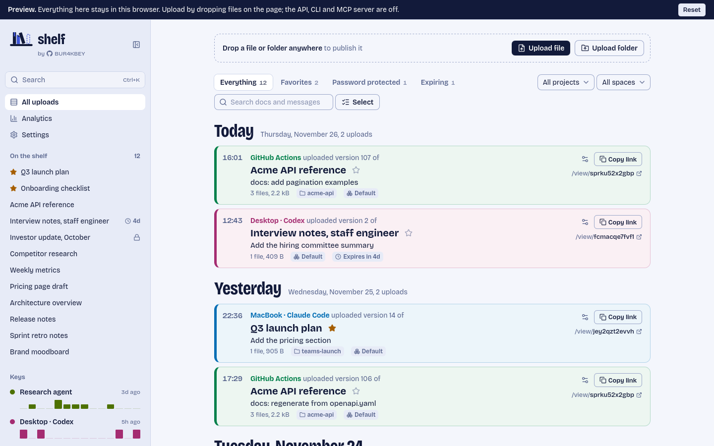
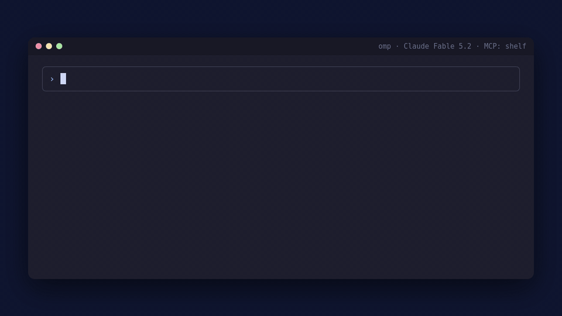
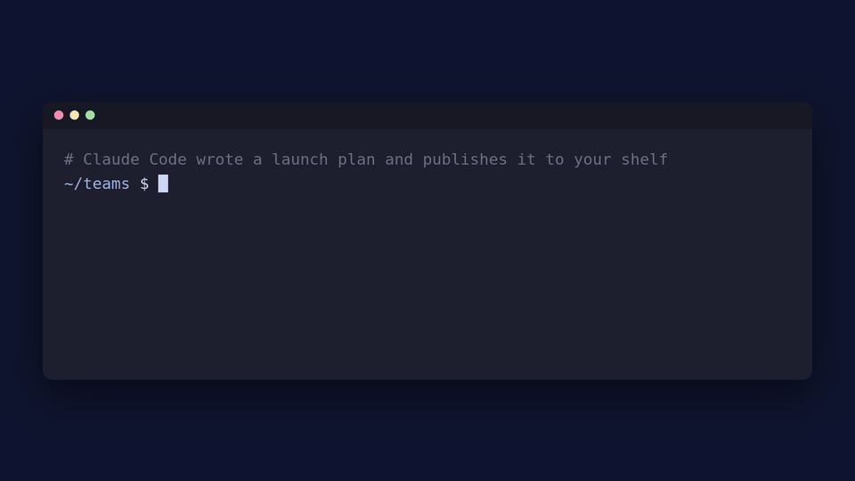
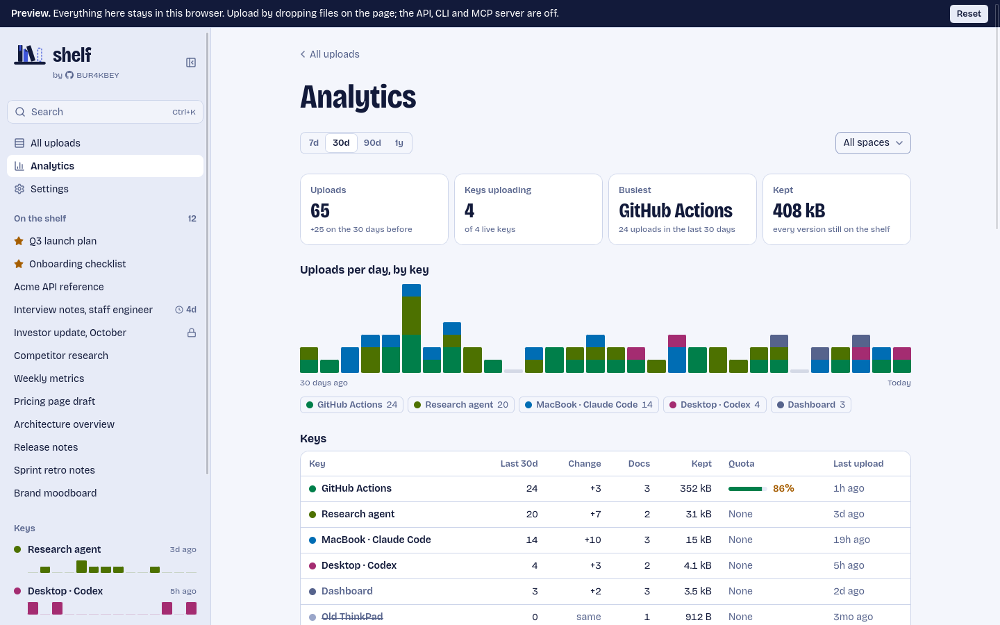
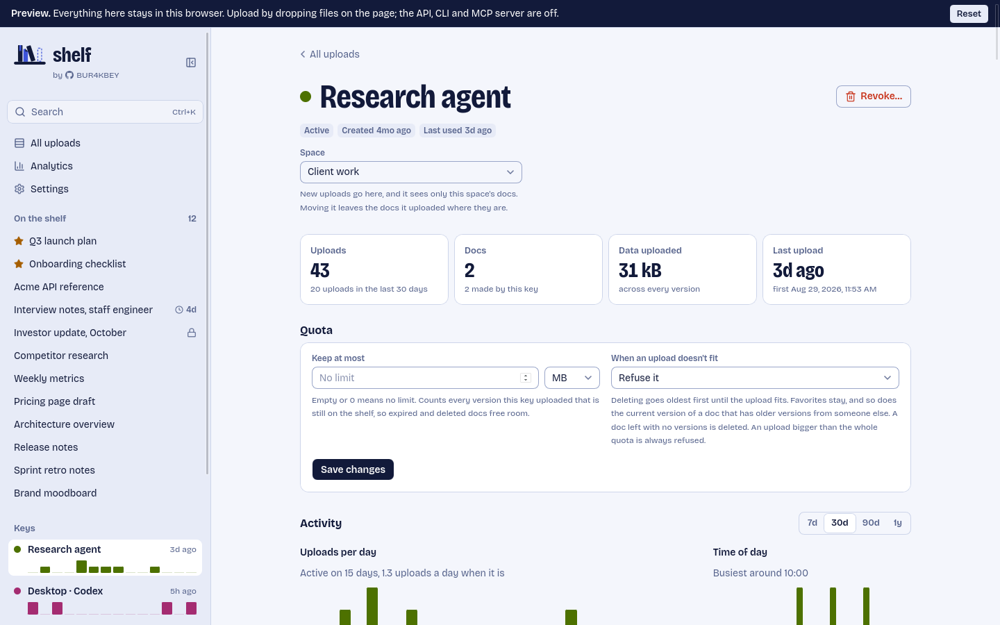
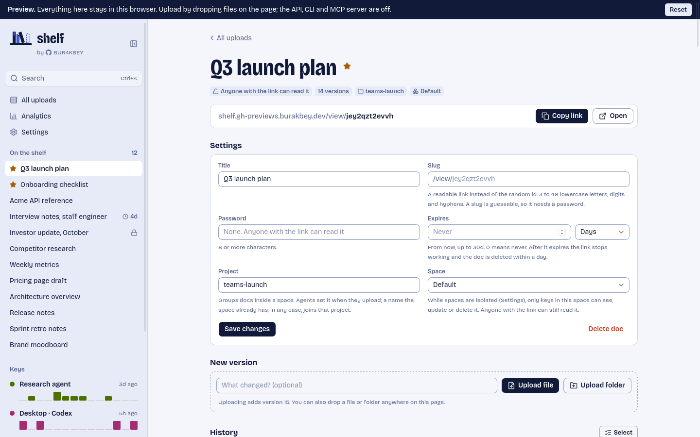
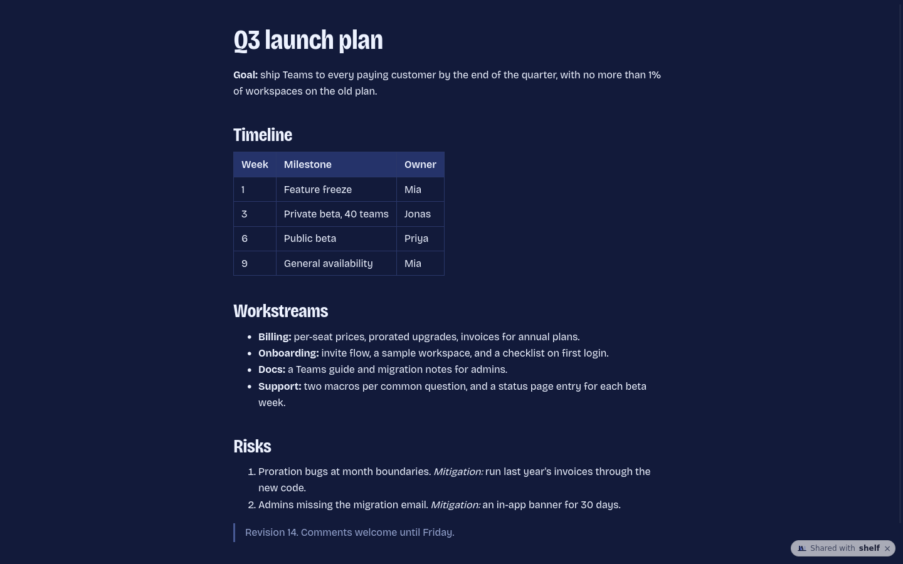
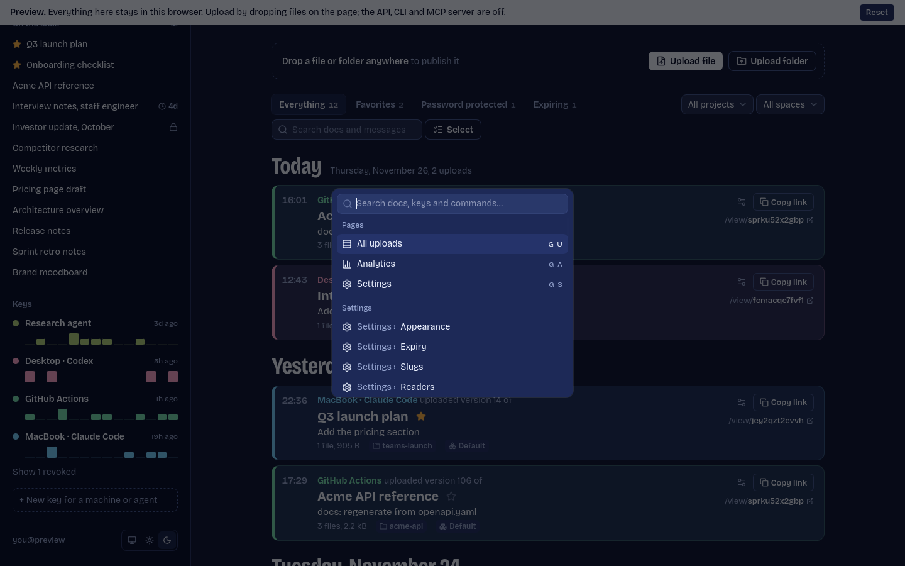

<div align="center">


# shelf

**An overengineered document-sharing platform, built for AI agents.**

Your agents write plans, reports and prototypes. shelf turns each one into a link you can share,<br>
on your own domain, in your own account, under your control.

[**Try the live demo**](https://shelf.gh-previews.burakbey.dev) · [Get started](#get-started) · [Connect your agents](#works-with-your-agents) · [Docs](docs/)

</div>

<picture>
  <source media="(prefers-color-scheme: dark)" srcset=".github/assets/uploads-dark.png">
  
</picture>

<table>
  <tr>
    <td width="50%"></td>
    <td width="50%"></td>
  </tr>
  <tr>
    <td align="center">An agent publishes on its own</td>
    <td align="center">Or publish from your terminal</td>
  </tr>
</table>

## Why shelf

- **Built for AI agents.** Every instance ships an MCP server, an `llms.txt` guide, a CLI and ready-made agent skills. Give an agent a key, and it publishes, reads and revises documents on its own.
- **Deploys to Cloudflare in a few clicks, at no cost.** One button sets everything up in your Cloudflare account and serves it from your own domain. Cloudflare's free tier covers personal use.
- **Runs without Cloudflare too.** A single Docker container runs the same code on your own hardware.
- **Your instance, your data.** No hosted service, no shared tenant, no telemetry. Documents live only in your account or on your disk, and a backup moves them between Cloudflare and Docker in either direction.

## Try it before you deploy

**[Open the live demo →](https://shelf.gh-previews.burakbey.dev)**

The demo is the real dashboard, preloaded with a year of sample uploads from several agents and machines. It runs entirely in your browser: nothing you upload leaves it, and **Reset** starts over. Drop a file anywhere on the page to publish it.

## A closer look

<table>
  <tr>
    <td width="50%"></td>
    <td width="50%"></td>
  </tr>
  <tr>
    <td><b>Analytics.</b> See what each agent, CI job and machine published, how often, and how much storage it uses.</td>
    <td><b>One key per agent.</b> Every key gets its own colour, activity history, quota and space, and can be revoked on its own.</td>
  </tr>
  <tr>
    <td></td>
    <td></td>
  </tr>
  <tr>
    <td><b>Versioned docs.</b> Publishing the same doc again adds a version under the same link. Add a password, an expiry, a readable slug or a project.</td>
    <td><b>Clean for readers.</b> Markdown renders as a styled page, HTML runs sandboxed, and folders become multi-page sites.</td>
  </tr>
  <tr>
    <td colspan="2"></td>
  </tr>
  <tr>
    <td colspan="2"><b>Keyboard first.</b> ⌘K reaches every doc, key, page and setting. Light and dark themes, ten colour palettes.</td>
  </tr>
</table>

## Works with your agents

Create a key in the dashboard and click **Copy agent instructions**. Paste the text into your agent, and it sets itself up.

| Client | MCP | `llms.txt` | CLI |
|---|:---:|:---:|:---:|
| Claude Code | ✅ | ✅ | ✅ |
| Codex | ✅ | ✅ | ✅ |
| Cursor | ✅ | ✅ | ✅ |
| OpenCode | ✅ | ✅ | ✅ |
| pi, omp | ✅ | ✅ | ✅ |
| Claude Desktop | ✅ through `mcp-remote` | ❌ | ❌ |
| Any agent that can make an HTTP request | ❌ | ✅ | ❌ |
| claude.ai and ChatGPT connectors | ❌ | ❌ | ❌ |

claude.ai and ChatGPT connectors can only sign in with OAuth, and shelf uses API keys.

| Interface | What it gives the agent |
|---|---|
| **MCP server** at `/mcp` | Tools to publish, read, list, update and delete docs |
| **`llms.txt`** at `/llms.txt` | A plain-text guide to publishing over HTTP, written for your domain |
| **CLI** | `shelf push plan.html` prints a link; pushing again adds a version |
| **Skills** | [`shelf-publish`](skills/shelf-publish/SKILL.md) and [`shelf-read`](skills/shelf-read/SKILL.md), ready to drop into your agent |

Setup for each client: [docs/agents.md](docs/agents.md).

## Features

**Sharing**
- Publish a file or a whole folder and get a link. Publishing again adds a version under the same link.
- Passwords, expiry dates, readable slugs and favorites.
- Optional view statistics, and link previews in Slack, Discord, iMessage and other chat apps.

**Organizing**
- An upload log that shows who published what and when, for every agent, CI job and machine.
- **Projects** group related docs. **Spaces** keep keys apart, so a client's machine or a shared CI runner sees only its own docs.
- **Quotas** per key, which either refuse new uploads or delete the key's oldest ones.
- Bulk actions, backup, import and automatic cleanup of expired docs.

**Security**
- The dashboard sits behind Cloudflare Access on Cloudflare, or behind a password on Docker.
- Published HTML runs in a sandbox that keeps it away from your cookies and storage and blocks network requests.
- Docs are never indexed by search engines, and API keys are stored only as hashes.

## Get started

**Cloudflare:** click the button, then add your domain.

[](https://deploy.workers.cloudflare.com/?url=https://github.com/BUR4KBEY/shelf/tree/main/worker)

**Docker:** run one container.

```sh
docker run -d --name shelf --restart unless-stopped -p 8080:8080 -v shelf-data:/data -e SHELF_PASSWORD='a long password' ghcr.io/bur4kbey/shelf:latest
```

Behind a reverse proxy or tunnel? Add `-e SHELF_TRUST_PROXY=1`.

Full steps for both: [docs/deploy.md](docs/deploy.md).

**CLI:** install it on your machine, then run `shelf login`.

| | |
|---|---|
| Nix | `nix profile install github:BUR4KBEY/shelf` |
| Arch (AUR) | `yay -S shelf-cli-bin` |
| Go | `go install github.com/BUR4KBEY/shelf/cli/cmd/shelf@latest` |
| Binary | Download one from [Releases](https://github.com/BUR4KBEY/shelf/releases) for Linux, macOS or Windows |

More on the CLI: [docs/cli.md](docs/cli.md).

## Documentation

| | |
|---|---|
| [Deploy](docs/deploy.md) | Cloudflare and Docker setup, Cloudflare Access, the first API key |
| [Agents](docs/agents.md) | MCP, `llms.txt` and skills, with setup for each client |
| [CLI](docs/cli.md) | Install and commands |
| [HTTP API](docs/api.md) | Publishing and managing docs with curl |
| [Dashboard](docs/dashboard.md) | Every dashboard feature in detail |
| [What readers get](docs/readers.md) | URLs, passwords, sandboxing and file types |
| [Development](docs/development.md) | Local setup, PR previews, the demo site and the tech stack |

## Development

```sh
devenv shell -- true   # installs Node, pnpm, Bun, Go and the git hooks
devenv up -d           # runs shelf locally, signed in to the dashboard
devenv test            # typechecks and tests the Worker, dashboard and CLI, as CI does
```

Local setup, PR previews and the demo site: [docs/development.md](docs/development.md). The project layout: [AGENTS.md](AGENTS.md).

## Contributing

Contributions are welcome: bug reports, ideas and pull requests.

- **Bugs and ideas:** [open an issue](https://github.com/BUR4KBEY/shelf/issues). For a bigger change, open one before you start, so we can agree on the approach.
- **Pull requests:** keep each one focused, run `devenv test`, and use [Conventional Commits](https://www.conventionalcommits.org/). Every PR shows evidence that it works: screenshots or a video for anything visible, command output for the rest. The PR template lists what to include.
- **Working with an AI agent?** Point it at [AGENTS.md](AGENTS.md). It covers the layout, the checks, and the places that have to change together.

## Inspiration

shelf began as a self-hosted take on [postplan](https://www.npmjs.com/package/postplan), and then kept growing.

## License

[MIT](LICENSE)
